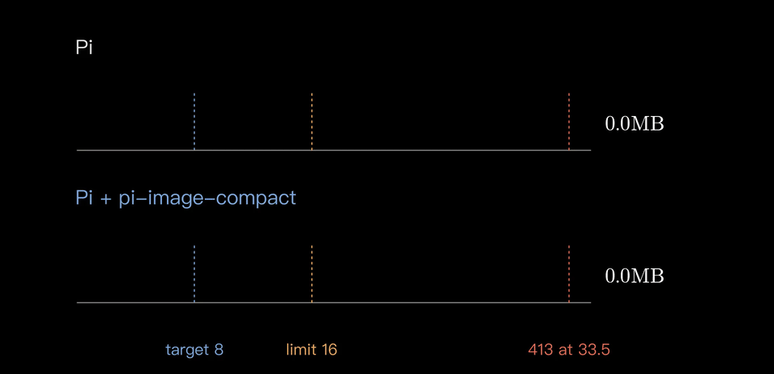
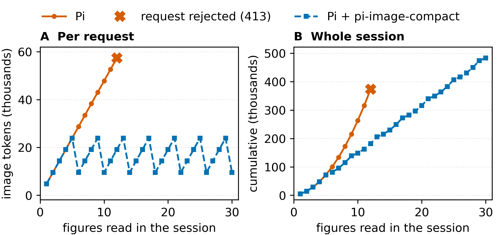

<p align="center"></p>

<p align="center"><a href="../README.md">English</a> · <b>简体中文</b> · <a href="README.es.md">Español</a> · <a href="README.ru.md">Русский</a></p>

# pi-image-compact

让图片很多的 [Pi](https://github.com/earendil-works/pi) 会话保持小巧，截图再多也不会以 413 "request too large" 错误收场。在一个推算的 12 张大图会话里，每次请求都保持在 16 MB 以下，整个会话发送的图片 token 少了约一半（182k 对 373k）。在 12 张公开截图、图表和照片的测试集上，WebP 让图片小了三分之一（3.22 → 2.16 MB）。

<p align="center"></p>

https://github.com/user-attachments/assets/0c29e6ea-4655-4c62-b5bc-14967bd5dcc7

也可以在 [YouTube](https://youtu.be/WFU_k1zRBbI) 上观看。

```bash
pi install npm:pi-image-compact
```

包含四个相互独立的扩展，每个都可以在 `pi config` 里单独关闭（说明为英文）： [compress](extensions.md#compress) · [budget](extensions.md#budget) · [prune](extensions.md#prune) · [status](extensions.md#status)

<p align="center"></p>

## 开发

```bash
npm install && npm test
```

## 参与贡献

我还在学习，非常欢迎任何想法、issue 和 pull request。

## 许可证

MIT
